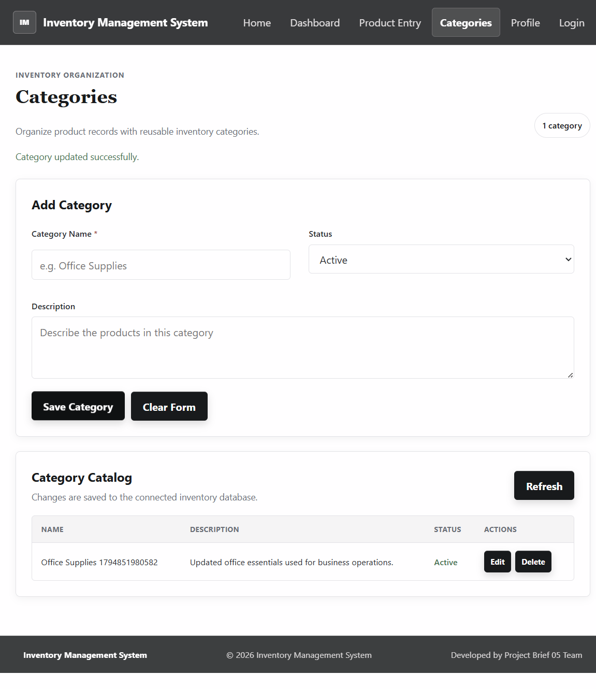
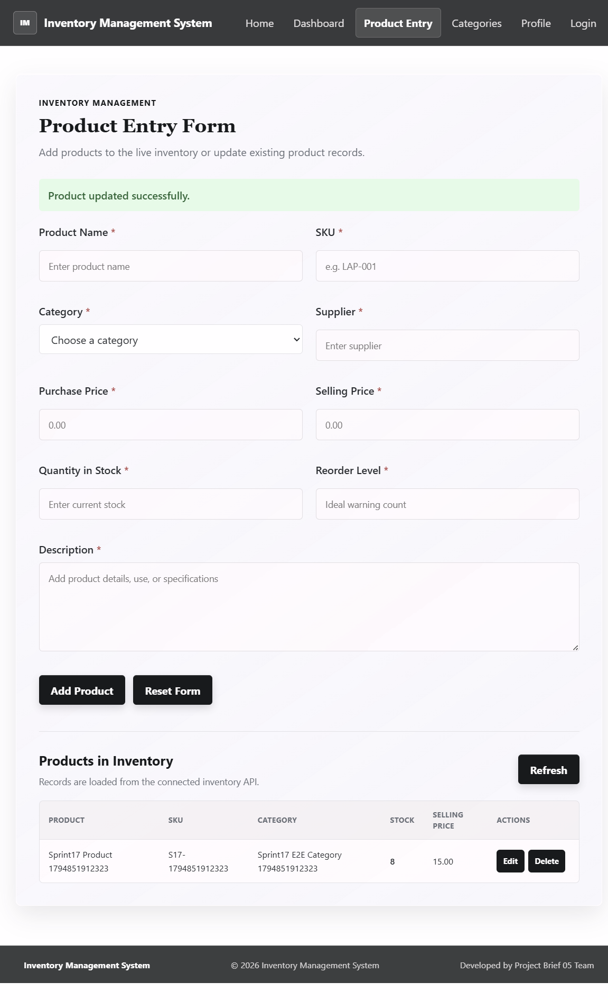

# Sprint 17: Category CRUD Module

## Module choice

The project planning requirements list Category Management as a core module. This sprint adds category management as the second end-to-end CRUD module alongside Products.

## Data structure

| Field | Type | Required | Default / validation |
| --- | --- | --- | --- |
| `name` | String | Yes | Trimmed, 2-60 characters, unique |
| `description` | String | No | Trimmed, max 250 characters |
| `isActive` | Boolean | No | `true` |
| `createdAt`, `updatedAt` | Date | Generated | Mongoose timestamps |

Categories are stored in the dedicated MongoDB `categories` collection. The existing Product API payload remains compatible; Product Entry now offers active category names from the Category API instead of relying on free-text entry.

## API

The Express application mounts `categoryRoutes.js` at `/api/categories`.

| Method | Endpoint | Result |
| --- | --- | --- |
| `POST` | `/api/categories` | Creates a category (`201`) |
| `GET` | `/api/categories` | Lists categories and count (`200`) |
| `GET` | `/api/categories/:id` | Retrieves a category (`200`) |
| `PUT` | `/api/categories/:id` | Updates allowed fields (`200`) |
| `DELETE` | `/api/categories/:id` | Deletes a category (`200`) |

Validation failures and invalid IDs return `400`, missing records return `404`, duplicate names return `409`, and unexpected errors use the existing generic `500` response. The Postman collection is `server/postman/Sprint17-Category-API.postman_collection.json`.

## React module

The Categories page is available at `/categories` and in the main navigation. It loads database records and supports creating, editing, and confirmation-based deletion. It reuses the established API client, loading indicator, button component, and request error handling. Product Entry uses active Category records in its category selector and preserves the category text of older products while editing them.

## Run and verify

1. Start MongoDB, then run `npm run dev` from `server/`.
2. Run `npm run dev` from `client/`.
3. Use **Categories** to create, edit, and delete a record; verify its collection in MongoDB Compass.
4. Confirm Product Entry loads active categories, then exercise Product CRUD and Category CRUD in the same app.
5. Import the Sprint 17 Postman collection, set `baseUrl`, and run its requests in order.
6. Run `npm test` from `server/`, and `npm run lint` and `npm run build` from `client/`.

Do not commit environment files, credentials, or real inventory data. For Sprint 17 evidence, capture the module page and CRUD flow, successful API requests, MongoDB collection, and navigation between Products and Categories.

## Captured UI evidence

The screenshots show the Categories page after a successful create and update, and the Product Entry page with a category assigned to a product. These records were created in an isolated test database and deleted after verification.

